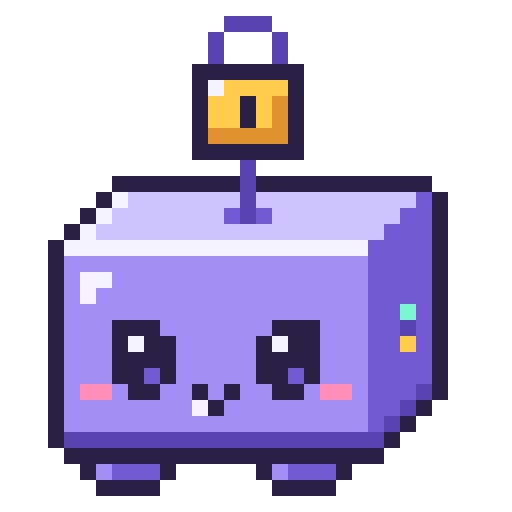
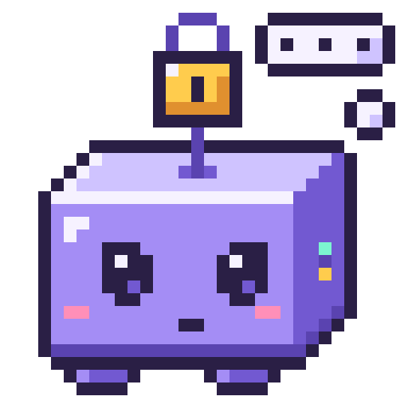
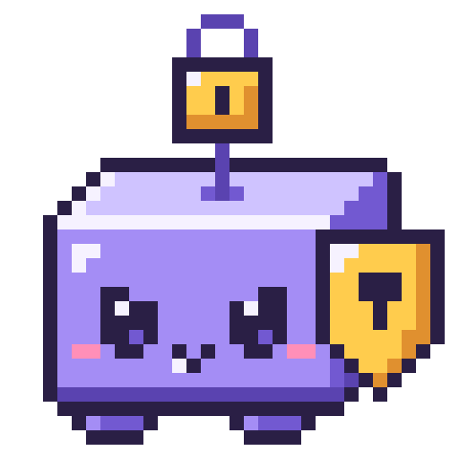
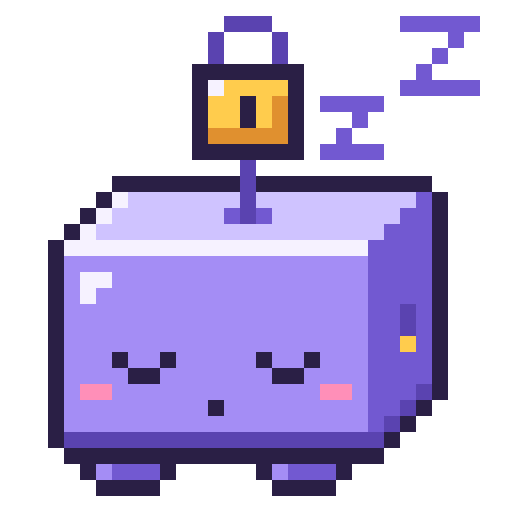

# Snib, the agentbox mascot

<p align="center">




</p>

This page is the style guide for Snib: the story, the palette, the sizes, the rules, the files and how to edit them.

## Story

Snib (it rhymes with "crib") is a small lockbox with feet. Its name is a Scots word for the little catch that bolts a door. Snib lives on a small server with no screen, and it gives every agent task a sealed room of its own. The gold padlock rides on its antenna, outside the box, because the keys never go in: the box holds no secrets, and before an agent does anything risky, Snib waits for its human to sign. The mint light on its side glows while an agent works. The tiny fang is its mischief. Let the agents make a mess in there. Snib can always roll back.

The story follows the agentbox design, and most of that design is not built yet. The [Roadmap](../docs/wiki/Roadmap.md) lists what is built and what is planned.

## Palette

Ten colors and transparent. Every file in [Use these](#use-these) uses only these. The key is the character that stands for the color in the grid JSON files.

| Key | Hex | Name | Use |
|---|---|---|---|
| `o` | `#2a1f45` | Ink | The 1 px outline of the body, padlock, feet and props. Eyes, mouth and keyhole. The outline of the wordmark letters and the holes in them. |
| `h` | `#f6f2ff` | Highlight | The lit edges of the top face, the glint on the front, the padlock glint, eye catchlights and the fang. The thought bubble and the lit corner of the shield. Background of the banner and the social preview. The ring of the ring version, where its key is `W`. |
| `t` | `#cfc3ff` | Light | Top face, and the shade in the thought bubble. In the banner and the social preview: the lit top of each letter, the wordmark's drop shadow, the shadow under the feet, and the frame of the social preview. |
| `f` | `#a48df5` | Body | Front face, and the lit corner of each foot. Wordmark fill. |
| `s` | `#7259d1` | Shade | Side face, feet, the socket around the antenna and the second catchlight in each eye. The tagline and the sleep Zs. |
| `d` | `#5a43b0` | Deep shade | Bottom band, the lower edge of the side face, padlock shackle, antenna stalk, unlit LEDs. |
| `p` | `#ff8fb8` | Blush | Cheeks. |
| `g` | `#ffcc4d` | Gold | Padlock, gold LED, shield. |
| `G` | `#e0902f` | Gold shade | Lower band and right column of the padlock. Shaded side of the shield. |
| `m` | `#7cf5d0` | Mint | Status LED, lit. Avatar background. |
| `.` | transparent | | Background. |

Light comes from the top-left. The top and left edges are lit. The right side and the bottom are in shade. The outline is Ink, not pure black. The shackle and the stalk are 1 px wide and have no outline: Deep shade is their line.

## Sizes

Every art pixel must cover a whole number of screen pixels. So show Snib only at a whole-number multiple of its grid.

| Art | Show it at | Files |
|---|---|---|
| 16 × 16 grid | 16 px (48 px at 3x also works) | `icons/favicon-16.png` |
| 32 × 32 grid | 32 px or any multiple: 64, 96, 128, 256, 512 | `icons/favicon-32.png`, `icons/icon-*.png`, `agentbox-mascot.png`, `poses/`, `anim/` |
| Banner, 160 × 40 grid | 640 px wide (4x) in a README. The file is 1280 × 320 (8x). | `banner.png` |
| Social preview, 160 × 80 grid | Upload as is: 1280 × 640 (8x). | `social-preview.png` |

- **No CSS (GitHub READMEs and wikis):** use a PNG at least as big as the display size. Set `width` to the PNG width divided by a whole number. For the 512 px files, that is 256, 128, 64 or 32. Never set `width` larger than the PNG.
- **With CSS:** add `image-rendering: pixelated;` before you scale a PNG up. The SVGs scale without blur, but they have no fixed size: always set `width` and `height`, as a multiple of the grid.
- **Minimum size:** 16 px, with the 16 grid. Never show the 32 grid below 32 px. Never make a small icon by shrinking the 32 grid: use `icons/favicon-16.png`. Poses and the idle loop have no 16 px version, so their minimum is 32 px. The banner minimum is 320 px wide (2x). Smaller, the tagline does not read.
- **Clear space:** leave at least 4 art pixels of empty space on every side, counted from the outermost art pixel. At 4x that is 16 px. Every 32-grid file except the ring version already has at least 1 empty art pixel on each side, so a margin of 3 art pixels around the image is enough: 12 px at 4x. The ring reaches the top and bottom edges of its image, so give it the full 4. Icons, favicons and the avatar fill their tile on purpose. This rule does not apply to them.

```html
<!-- GitHub README: the 512 px PNG at a quarter, 4 screen px per art pixel -->


<!-- favicons -->
<link rel="icon" type="image/png" sizes="16x16" href="favicon-16.png">
<link rel="icon" type="image/png" sizes="32x32" href="favicon-32.png">
```

## Do

- Use the files as they are, at the sizes above.
- Put Snib on a flat background: transparent, white, GitHub dark, or a palette color. The banner uses Highlight `#f6f2ff`. The avatar uses Mint `#7cf5d0`.
- Use the ring version, `refine/r2/grid32-ring.png`, on photos, busy backgrounds and stickers.
- Pick the pose that fits the message. The [file list](#use-these) says what each pose is for.
- Write alt text that names Snib, for example `alt="Snib, the agentbox mascot, asleep"`.

## Do not

- Do not smooth. No bilinear or bicubic resizing, no anti-aliasing, no blur. Do not save as JPEG or another lossy format: use PNG or SVG.
- Do not scale by a fraction, such as 1.5x or `width="100"`. Do not stretch: both axes get the same scale.
- Do not recolor. Use no color outside the palette: no tints, gradients, opacity, filters, drop shadows or glows.
- Do not flip or rotate Snib. The light comes from the top-left, and the LEDs sit on the right side.
- Do not change Snib. Put no text or logo on the body. Keep the padlock, the LEDs, the cheeks and the feet.

## Files

### Use these

| File | Size (px) | For |
|---|---|---|
| `agentbox-mascot.png` | 512 × 512 | The main image. The README footer and the wiki home show it at `width="128"`. |
| `agentbox-mascot.svg` | 32 × 32 viewBox | Web pages that size it with CSS. |
| `banner.png` | 1280 × 320 | Top of the main README, at `width="640"`. Transparent rounded corners. |
| `social-preview.png` | 1280 × 640 | GitHub repo Settings, Social preview. Fully opaque, because some sites draw transparency as black. |
| `icons/favicon-16.png` | 16 × 16 | Browser tab. Drawn from the 16 grid. |
| `icons/favicon-32.png` | 32 × 32 | Browser tab on high-density screens. |
| `icons/icon-64.png`, `icon-128.png`, `icon-256.png` | 64, 128, 256 | App and document icons: the 32 grid at 2x, 4x and 8x. |
| `icons/avatar-460.png` | 460 × 460 | GitHub org or bot avatar. Snib at 12x on Mint, centred so the circle crop keeps all of it. |
| `poses/happy.png`, `.svg` | 512 × 512 | The default. Same pixels as `agentbox-mascot.png`. |
| `poses/thinking.png`, `.svg` | 512 × 512 | Work in progress, planning, loading. Eyes up on a thought bubble. |
| `poses/guarding.png`, `.svg` | 512 × 512 | Security pages and approval prompts. Brows down, a gold shield with a keyhole. |
| `poses/sleeping.png`, `.svg` | 512 × 512 | Idle, standby and empty states. Eyes shut, Zs, mint LED off. |
| `anim/idle.svg` | 32 × 32 viewBox | Idle loop: 4 frames of 500 ms, a 2 s loop that never stops. For waiting screens. In docs, use a still image: a loop next to text distracts, and WCAG 2.2.2 asks for a way to pause motion that runs over 5 s. |
| `anim/idle.png`, `idle-f1.png`, `idle-f2.png`, `idle-f3.png` | 512 × 512 each | The 4 frames: rest, blink, breathe out, breathe out with the mint LED off. For tools that build an animation from frames. |
| `anim/idle-sheet.png`, `.svg` | 1072 × 256 | The 4 frames in a row, at 8x, with 2 art pixels between them. |
| `refine/r2/grid32-ring.png`, `.svg` | 512 × 512 | Die-cut version with a 1 px Highlight ring. |

### Sources

| File | What it is |
|---|---|
| `refine/r2/grid32.json` | **The master:** Snib on the 32 grid. Every file in the list above comes from it, except `favicon-16.png`. |
| `refine/r2/grid16.json` | The 16 grid master, drawn on its own for `favicon-16.png`. |
| `refine/r2/grid32-ring.json` | The ring version: the master plus a 1 px `W` (`#f6f2ff`) on every empty pixel that touches the art, corners included. Step 4 of [Change Snib](#change-snib) remakes it. |
| `refine/r2/build.py` | The record of how the masters were made from concept c3. When it runs, it rewrites `grid32.json`, `grid16.json`, `grid32-ring.json`, `idle32.json` and `compare32.png` in `refine/r2/`. |
| `tools/px.py` | Renders a grid JSON to PNG and SVG. |
| `icons/build.py` | Makes `icons/` and `agentbox-mascot.png` and `.svg`, then checks every output pixel against the grid. |
| `poses/build.py` | Makes `poses/*.json` and `poses/review/sheet.png`. |
| `anim/build.py` | Makes `anim/idle.json` and `anim/idle-sheet.json`. It checks each frame for a clean outline and no new stray pixels. |
| `banner-src/build.py` | Makes `banner.png`, `social-preview.png` and `banner-src/preview.png`, and checks every output pixel. It draws the wordmark and tagline letters as pixels. |
| `poses/*.json`, `anim/*.json`, `banner-src/*.json` | Grids that the scripts write. Do not edit them: the next build overwrites them. |

`refine/r2/grid32.png`, `grid32.svg`, `grid16.png` and `grid16.svg` are renders of the masters, for review.

### Review images

| File | Shows |
|---|---|
| `icons/preview-icons.png` | Each icon at 1x on white, GitHub dark and light and dark browser tab bars. The favicons also at 4x. |
| `icons/preview-avatar.png` | The avatar at half size, square and circle-cropped. |
| `poses/review/sheet.png` | Each pose at 1x, 2x and 4x on white and GitHub dark, and as a solid silhouette. |
| `banner-src/preview.png` | The banner on a light and a dark README, and the social preview. |
| `refine/r2/compare32.png` | The last two design rounds and the ring version, with silhouettes. A record: the rebuild in [Change Snib](#change-snib) does not remake it. |

### Working files

The design history. You do not need these files to use the art or to rebuild it, with the exceptions below.

- `concepts/c1` to `concepts/c5`: the five first concepts. Snib is `c3`.
- `judges/`: the reviews that compared the concepts.
- `refine/r1/`, `refine/r1-critic/`, `refine/r2-visual-critic/`, `refine/r2/try/` and `refine/r2/idle32.*`: earlier rounds and an older idle loop.
- `icons/try/` and `banner-src/try/`: scratch tests of avatar backgrounds, favicon zooms, an SVG render, and banner and social preview layouts.

Exceptions: `poses/build.py` and `refine/r2/build.py` import `judges/j3/sheet.py`. `refine/r2/build.py` also reads `concepts/c3/` and `refine/r1/grid32.json`. Keep these files if you prune the rest.

## Edit the art

Run every command from this folder. The tools are Python 3 with the standard library only. `-I` runs Python in isolated mode: files in the current folder and `PYTHON*` environment variables cannot change what runs.

The build scripts name this folder by its full path, in `M` near the top of each script. `poses/build.py` and `refine/r2/build.py` also have the path in their `sys.path.insert` line. In a new copy of the repo, change these lines to your path first. `tools/px.py` needs no change.

### Grid format

```json
{
  "palette": {".": "transparent", "o": "#2a1f45", "f": "#a48df5"},
  "rows": [".oo.", "offo", ".oo."]
}
```

One character is one pixel. Every row must have the same width, and every character must be a palette key. For an animation, replace `"rows"` with `"frames": [[rows], [rows], ...]` and add `"ms"`, the time of each frame in milliseconds.

### Render

```sh
python3 -I tools/px.py refine/r2/grid32.json /tmp/snib            # /tmp/snib.png at 16x (512 px) and /tmp/snib.svg
python3 -I tools/px.py refine/r2/grid32.json /tmp/snib --scale 1  # real size
```

`--scale` sets the PNG scale. The default is 16. For an animation, px.py writes frame 0 to `<out>.png`, frame N to `<out>-fN.png`, and all frames to one animated `<out>.svg`. It stops with an error such as `row 3 has width 31, want 32` or `row 3: char 'x' not in palette`.

### Change Snib

1. Edit `refine/r2/grid32.json`. If the change must show at 16 px, edit `refine/r2/grid16.json` too.
2. Render it. Look at the PNG at 16x and at 1x: the face must still read at 1x.
3. Check the silhouette in solid black:

   ```sh
   python3 -I -c 'import json,sys; g=json.load(open(sys.argv[1])); g["palette"]={k: v if v=="transparent" else "#000000" for k,v in g["palette"].items()}; json.dump(g,open(sys.argv[2],"w"))' refine/r2/grid32.json /tmp/snib-sil.json
   python3 -I tools/px.py /tmp/snib-sil.json /tmp/snib-sil --scale 8
   ```

4. Rebuild every file that comes from the masters. The first two lines remake the review renders of the masters. The last two remake the ring version with the rule in [Sources](#sources).

   ```sh
   python3 -I tools/px.py refine/r2/grid32.json refine/r2/grid32
   python3 -I tools/px.py refine/r2/grid16.json refine/r2/grid16
   python3 -I icons/build.py
   python3 -I poses/build.py
   for p in happy thinking guarding sleeping; do python3 -I tools/px.py poses/$p.json poses/$p; done
   python3 -I anim/build.py
   python3 -I tools/px.py anim/idle.json anim/idle
   python3 -I tools/px.py anim/idle-sheet.json anim/idle-sheet --scale 8
   python3 -I banner-src/build.py
   python3 -I -c 'import json,sys; g=json.load(open(sys.argv[1])); A=g["rows"]; h,w=len(A),len(A[0]); at=lambda x,y: A[y][x] if 0<=x<w and 0<=y<h else "."; g["palette"]["W"]="#f6f2ff"; g["rows"]=["".join("W" if A[y][x]=="." and any(at(x+i,y+j)!="." for i in (-1,0,1) for j in (-1,0,1)) else A[y][x] for x in range(w)) for y in range(h)]; json.dump(g,open(sys.argv[2],"w"),indent=1)' refine/r2/grid32.json refine/r2/grid32-ring.json
   python3 -I tools/px.py refine/r2/grid32-ring.json refine/r2/grid32-ring
   ```

5. Look at the review images: `icons/preview-icons.png`, `poses/review/sheet.png`, `banner-src/preview.png` and `refine/r2/grid32-ring.png`.

Before you edit, know this:

- `poses/build.py` and `anim/build.py` paint at fixed pixel positions. If you move the eyes, the mouth or the LEDs, update the positions in both scripts. `anim/build.py` stops if a pixel it changes does not hold the color it expects.
- Do not run `refine/r2/build.py` after a hand edit. It rebuilds the masters and the ring from `concepts/c3/` and drops your change.

### Add a pose

In `poses/build.py`, add a line such as `wave = pose((stamp, x, y, ["rows"]), ...)`. In a stamp, `_` keeps the pixel below it. Add the pose to `POSES`, and add its name to the render loop in step 4. Keep the body where it is, so that poses swap in place. Keep the 1 px empty border: the script checks it.

### Drawing rules

- Use only palette colors.
- Light from the top-left: highlights on the top and left edges, shade on the right and bottom.
- Draw a 1 px Ink outline around the body and every prop. The shackle and the antenna stalk are 1 px Deep shade lines with no outline. The sleep Zs are 1 px Shade lines with no outline.
- No anti-aliasing and no stray pixels. A pixel that touches no pixel of its own color, not even at a corner, must be a planned detail, such as a glint, an LED or the fang.
- Keep a 1 px empty border around the 32 grid. The ring version needs it.

## License

The art is licensed under [CC BY 4.0](https://creativecommons.org/licenses/by/4.0/). The code is licensed under Apache-2.0, like the rest of agentbox.

| What | Files | License |
|---|---|---|
| Art | Every `.png`, `.svg` and grid `.json` file in this folder | [CC BY 4.0](https://creativecommons.org/licenses/by/4.0/) |
| Code | `tools/px.py`, every `build.py` and every other `.py` file in this folder | Apache-2.0, see [LICENSE](../LICENSE) |

Changes to the art that you contribute are under CC BY 4.0. Changes to the code are under Apache-2.0.

Why the art does not use Apache-2.0: Apache-2.0 is written for software. Its terms speak of source code, object code, patents and NOTICE files. Anyone who passes the work on must include a copy of the license and mark the files they changed. That fits a code repository, not a sticker, a slide or a blog post. CC BY 4.0 is written for creative work. It allows the same things: copy, change, share and sell. It asks only for credit in a form that suits the medium, a link to the license, and a note if you changed the art. Creative Commons advises against its licenses for software, so the code stays Apache-2.0.

Credit line:

```text
Snib, the agentbox mascot, by the agentbox contributors. CC BY 4.0: https://creativecommons.org/licenses/by/4.0/
Source: https://github.com/dbabi/agentbox/tree/main/mascot
```

Neither license grants trademark rights. CC BY 4.0 also does not let you suggest that the agentbox project endorses you or your use of the art.
